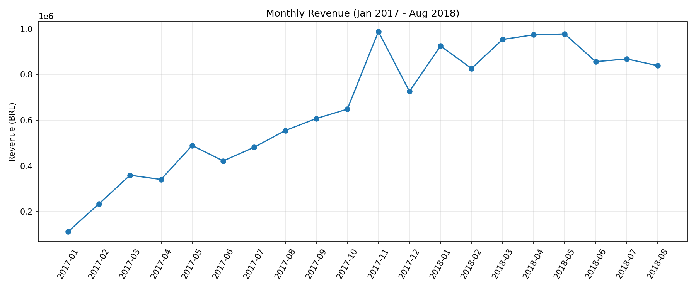
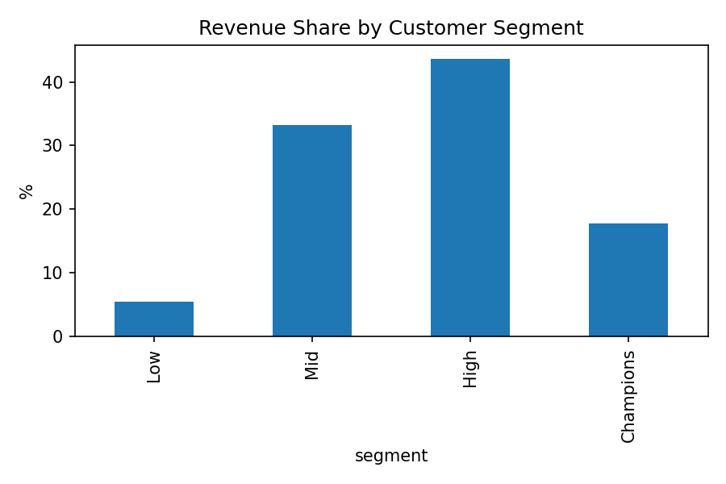

# Olist E-commerce Analysis

## Problem
Brazilian e-commerce orders ka analysis: revenue trends, top categories,
customer retention aur delivery performance ka review score par asar.

## Dataset
Olist Brazilian E-commerce (Kaggle): 96K delivered orders, 93K unique customers.

## Tools
Python (Pandas, Matplotlib), SQL (SQLite: CTE, JOIN, window functions), Google Colab

## Key Insights
- Total revenue R$13.2M from 96K delivered orders
- Revenue grew ~51% from Aug 2017 to Aug 2018
- Nov 2017: 52% revenue spike (Black Friday)
- Top 5 categories drive ~40% of revenue; watches_gifts has the
  highest order value, bed_bath_table the most orders
- Late deliveries (6.7% of orders) cut avg review score from 4.29 to 2.27
- Only 3% of customers are repeat buyers
- High + Champions segments (~38% of customers) drive ~61% of revenue

## Recommendations
- Plan inventory and ads early for Black Friday
- Send follow-up offers to convert one-time buyers into repeat buyers
- Loyalty program for Champions segment
- Monitor carrier SLAs and send proactive updates for late-risk orders
- Promote premium categories like watches_gifts

## Charts

## Files
- olist_analysis.ipynb: full Python + SQL analysis
- Dataset: https://www.kaggle.com/datasets/olistbr/brazilian-ecommerce
